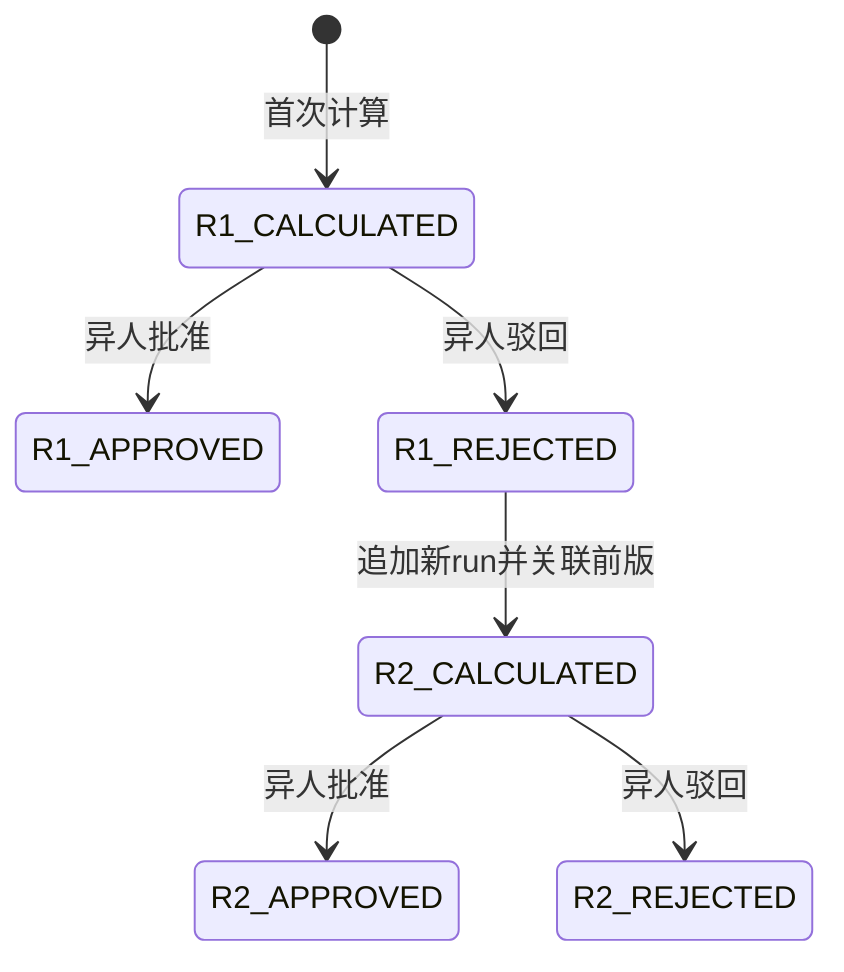
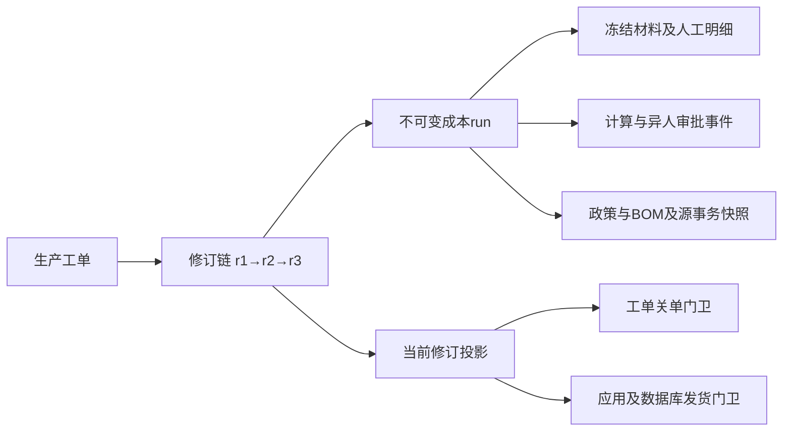

# Batch 2 制造成本不可变修订设计

## 状态、目标和证据

状态为DESIGN_ONLY，依据916f63f及本批未改变的成本实现；负责人只批准复现、方案和隔离验证，未批准正式修订规则或迁移。本批没有成本原型并入业务候选。目标是让独立驳回后的成本可以继续纠正，同时保留原计算、审批、金额和下游引用。

真实PG在两个BOM基数样本中再次确认：首次计算→异人REJECTED→新计算23505，旧工单无法CLOSED。旧run和事件不可更新/删除（0048迁移16–27、50–73）；本批保留该约束和历史测试，不把特征测试通过说成问题修复。

| 现状事实                                                       | 源证据                                                                                                      | 设计影响                                     |
| -------------------------------------------------------------- | ----------------------------------------------------------------------------------------------------------- | -------------------------------------------- |
| 每tenant+工单唯一run，run及事件不可变；驳回终态                | packages/database/migrations/0048_actual_manufacturing_cost.sql:16–73                                       | 不能覆盖原run，不能仅删除唯一约束            |
| 关单、数据库发货放行、应用预检都接受任意APPROVED               | 0048:62–67；0051_shipment_sales_order_source_compatibility.sql:15；apps/api/src/shipment-repositories.ts:73 | 必须统一当前成本版本，避免旧批准给新驳回兜底 |
| 工单固定产品/路线，没有BOM版本列；成本按最新published_at选BOM  | 0041_production_execution_foundation.sql:4–12；production-cost-repositories.ts:123–129                      | 原BOM无法可靠回填，新修订必须明确依据        |
| run有policy_id、material/labor快照和公式trace；政策/费率不可变 | production-cost-repositories.ts:154–235；0048:3–27、69–73                                                   | 可保留政策与金额证据，不等于已证明原BOM版本  |
| 有run即隐藏核算；页面只有批准动作，后端已有reject              | apps/web/src/commercial/production-cost-view.ts:32–57、100–117；routes/production-cost-decisions.ts:41–72   | 新增明确修订/驳回交互，不能依赖脚本          |

## 推荐状态机

每个run继续不可变；事件投影状态，不把“驳回后修订”解释为修改驳回记录。推荐首版范围仅允许REJECTED后新修订，APPROVED与已关单更正另议。

图中R1_REJECTED到R2不是旧run状态变化。后续每次修订完整生成新明细及来源快照；不得拼用旧汇总和新材料。尚不新增CANCELLED/撤回状态。若业务允许待审撤回，需定义谁能撤回、事件及幂等、撤回后关单是否仍阻断；不能默默把撤回当批准或回退旧批准。

推荐“当前版本”是最新合法修订，当前版本APPROVED才满足成本门卫；任一旧APPROVED不能替代。若未来允许批准后新修订，需同时约定生效时点和已发生发货/关账的处理，不能只改查询排序。

## 数据结构和引用图（提案）

优先新增append-only修订关联表，不为回填编号UPDATE既有不可变run：

| 对象                               | 最小字段和约束                                                                                                                                                                               | 权威                                                   |
| ---------------------------------- | -------------------------------------------------------------------------------------------------------------------------------------------------------------------------------------------- | ------------------------------------------------------ |
| production_cost_revision_links     | tenant_id、production_order_id、run_id、revision_no、previous_run_id、reason、basis_hash、created_by；unique(tenant,order,revision)、unique(tenant,run)；复合FK确保前版/当前版均同工单同租户 | 修订身份与前后链；原run金额不改                        |
| production_cost_run_basis          | run_id、policy_id、product/routing/BOM版本、各层BOM选择清单、源报工/材料事务ID、计算截止点、材料计价来源、公式/舍入版本及hash                                                                | 本次计算的冻结依据；新记录一次写入                     |
| effective_production_cost_revision | 从关联表取每工单最高revision并连原run/event投影                                                                                                                                              | 唯一当前版本及状态；首期可用派生视图，无需另造可变总账 |
| 新修订命令结果                     | tenant、command_type、intent_key、原工单/前run、actor、规范输入hash、结果run_id                                                                                                              | 幂等恢复；不得按新payload绕过原对象当前权限            |

建议复合FK同时约束(run,tenant,order)，必要的唯一索引通过新迁移增加，不能只校验UUID格式。前版必须恰是已锁工单的当前run，revision必须连续，首版无前版，后版有前版；并发唯一与触发校验都要成立。当前视图不是独立会计账，不承担法定记账权威。

报价成本、原订单价格/毛利不因实际成本修订而重写。工单/发货应引用确切批准run及批准事件，而非只记录“成本已批”布尔值。经营利润再按该确切版本归集；修订后已下游引用的旧版本继续可追溯。

## 版本、金额和审批依据

新修订默认建议沿用原不可变政策；BOM已证时沿用原pin。历史run缺BOM ID时标LEGACY_UNVERIFIED，保留原snapshot/hash；若要重算，必须明确选择并批准新的BOM依据，不能按当前最新版本臆造原依据。换政策、换BOM或加入晚到材料/报工必须列差异和原因，不可隐藏在普通“重新提交”中。

计算与修订必须保持原COMPLETED工单门卫。材料、人工、机器、间接费重新逐项计算，snapshot记录源业务ID/数量/费率及截止点。审批人必须与本次计算人不同，不能因新版本换了提交者就由原计算者自批同一意图。审批时检查currentRunId/版本，审批旧版冲突拒绝，不自动切换另一版。

现0048:39–45的run guard还要求所有已发布BOM的材料都有费率；未来显式pin某个BOM后，其他发布版仍可能阻断计算。新迁移必须使覆盖校验针对本次已选BOM及实际材料，并测试旧版材料/替代料/缺费率，不能只改应用查询。

正式金额算法不在本批更改。TD-COST-001已用独立PG样本确认分项舍入和独立总额会触发精确总额CHECK；必须先批准精度与总额层级，并保留正确约束，不能用修订功能绕过金额不一致。

## API与前端提案

现有POST /production-cost-runs作为首次计算，现有/:id/approve和/reject保留；新命令建议POST /production-orders/:id/cost-revisions，输入previousRunId、expectedCurrentRunId、依据选择/原因和intentKey。GET工单成本返回当前run及修订时间线，单个run详情持续可访问但执行当前权限。此处新接口仅为设计，尚未添加。

事务顺序：当前会话/动作和字段权限→稳定命令锁→按原命令对象检查重放权限→锁工单→检查expectedCurrentRunId及前版REJECTED→冻结依据并核金额→写run/明细/初始事件/修订链/审计/outbox/命令结果→提交。修订、批准、驳回、关单与发货成本门卫应统一先锁工单、再按稳定顺序锁run，在锁内重读当前版本/状态；多工单按ID排序，不能让审批与修订交错通过陈旧current检查。

失败任何一步整笔回滚，不预占修订号留下半版。重复同键同输入返回原结果且无重复；异输入409须单独定义为新命令合同，不偷偷改变旧首次计算的唯一拒绝行为。

前端按工单显示“第N版/当前/历史/待审批/已驳回”，明确修订原因和差异；REJECTED当前版显示“创建修订”，原版只读；待审版显示异人批准/驳回及理由/evidence；保存失败保留表单和同一意图标识，可查询结果后恢复。依据缺失说明“历史BOM版本未证，需要明确选择”，禁止原始JSON、prompt或手工SQL作为日常操作。

## 向前迁移、兼容和回退

1. 新迁移只增加关联/依据表、复合约束、当前视图；对每个旧run INSERT关联r1，不UPDATE旧run。历史依据只能填已有可证字段，未知明确标记。
2. 过渡期旧唯一约束仍保留；新应用读取修订链，新增普通首次run必须自动获得r1关联（受控INSERT触发器或已兼容应用路径），否则旧应用并存时会产生漏链。
3. 关单和发运的三处门卫切至同一当前视图，并验证旧单一run行为完全相同；新审批检查当前版。修订功能仍关闭，先做兼容回归和故障演练。
4. 规则获批后，新的前滚迁移用修订唯一/前版/命令约束替代原每工单单run限制，才开启追加修订。不是直接删除约束消除23505。
5. 产生多修订后，不可直接回退916f63f等只理解单版的应用；它会误取旧批准或隐藏计算入口。停止新修订不删除历史，只可回到明确兼容多版的构建，必要时前滚修复。生产迁移/恢复另行授权。

## PG、HTTP和岗位验收设计

| 场景                                            | 独立预期                                                     |
| ----------------------------------------------- | ------------------------------------------------------------ |
| r1异人驳回→r2计算→异人批准→关单/放行            | r1及其拒绝证据不变，下游绑定r2和批准事件                     |
| 旧版批准/最新版未批或拒绝                       | 按批准规则阻断，不接受任意旧批准                             |
| 同前版双并发修订                                | 一个合法当前版本，另一个明确冲突；无双明细/事件              |
| 同键重放/异输入/撤权后重放                      | 合法返回原run，无额外写；当前权限不足拒绝；异输入按新合同409 |
| 明细/审批/关联/outbox晚失败                     | 全部回滚，原当前版和历史不变                                 |
| 原BOM后发布、费率变更、多层替代料               | 旧run及pin不变，新修订明确依据；金额和数量独立对账           |
| 历史未证BOM、旧程序首次写入、多版程序回退       | 不造历史ID，不漏r1，兼容失败明确阻断发布                     |
| 跨租户/自批/旧版本审批/错误expectedCurrentRunId | 数据库及HTTP拒绝且无额外业务写入                             |

## 最小业务裁定

| 决策            | 推荐首版                                         | 备选与影响                                                       |
| --------------- | ------------------------------------------------ | ---------------------------------------------------------------- |
| C1 修订资格     | 仅当前REJECTED后，APPROVED/CLOSED不可普通修订    | 批准后或关账后更正需调整单/生效和利润追补规则                    |
| C2 依据选择     | 沿用原政策和可证BOM；未知历史BOM先明确批准新依据 | 允许自由选新版必须强制差异、授权和新版本标签                     |
| C3 当前有效口径 | 当前最新修订APPROVED才满足关单和发运             | “最后批准版本”可保业务连续但会在新驳回时继续放行，需明确风险接受 |
| C4 撤回         | 首版不引入待审撤回，驳回后修订                   | 增加撤回终态和再提交会扩大状态机及审计要求                       |

上述均为待批准方案；实现、迁移、金额口径和生产操作分别按范围授权。本文件可独立修订回退，不表示TD-COST-002已解决。
