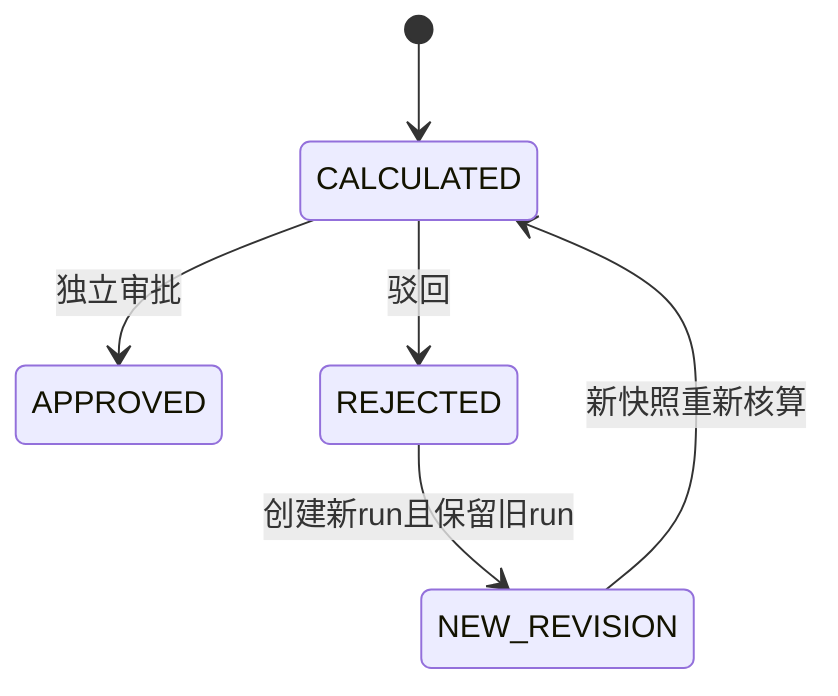

# Batch 3 业务设计增量与最小待决项

基线19d40a2；本批沿用[Batch 2 成本修订](batch2-cost-revisions.md)、[发运设计](batch2-shipping-inventory.md)、[金额/BOM/利润映射](batch2-money-bom-profit.md)，只补足决策和实施条件。本文方案均非正式业务实现；Batch1产出基数和MRP订单来源规则保持，不重复审批。以下事实来自本地源码，不代表人工岗位验收或生产观察。

## 金额和成本：M1、C1–C4

事实：production-cost-repositories.ts:165起用Number生成各分项/总额，再各自toFixed(6)；0048迁移要求已存总额等于已存分项之和，variance_total等于已存actual_total减planned_total。费率/材料单价非负，但差异可负。在该仓储103–287及0048全文范围内未见金额审批阈值，不推断其他系统不存在该规则。报价已有定点契约，本批不替换算法。

M1最小裁定：选定金额/数量/单价/费率各自精度、正负tie舍入模式、在哪个步骤量化，以及余差是否单列。推荐明确十进制定点：先按批准精度存各成本分项，再精确求已存总额；差异取已存总额之差，不能删除数据库一致性约束。备选先合计再舍入需要显式余差项目及账务解释。币种精度不等于所有成本中间值都应两位；隔离模型的两位仅是合成例。阈值若新增，另定负差异/恰好等于/舍入前后的比较规则。旧run和批准证据不回算。

推荐成本修订状态机（待批）：

REJECTED本体不再改写；NEW_REVISION是操作概念，不擅自增加现行枚举。若要引入DRAFT/SUBMITTED/撤回，需另裁定其权限与事件。新run需保存predecessorRunId/revision/current引用、确切policy/BOM逐层版本、价格快照、原料/报工明细及canonical hash；重新计算所有明细，不能只复制已拒绝总额。原审批/拒绝事件保持不可变。

| 决策          | 推荐                                                                                                                                             | 备选及兼容影响                                                         |
| ------------- | ------------------------------------------------------------------------------------------------------------------------------------------------ | ---------------------------------------------------------------------- |
| C1 修订资格   | 尚未关闭工单的最新REJECTED允许原申请人或已授权核算岗创建新run；申请人可再提交，审批必须异人                                                      | 仅主管可新建会增加交接；已批准/已关闭重开需独立冲销规则，本批不启用    |
| C2 当前版切换 | 新修订提交核算成功后成为current candidate；只有该版APPROVED才可关单/放行；不回落旧APPROVED                                                       | 以“最后批准版”持续有效可能掩盖正在修订的错误成本，须明确例外           |
| C3 版本引用   | 工单锁→current run→审批事件统一串行；修订、批准、关单及发运门卫均在同一工单锁下重读current；幂等键绑定工单/修订意图，expectedCurrentRunId冲突409 | 现行单run事件锁不足以处理跨修订竞态；仅加revision列不能消除竞态        |
| C4 下游与历史 | 新下游引用确切APPROVED run；已出报价/订单/关闭单据保留原引用，变更走独立审批差异                                                                 | 不补造旧历史pin；旧单run映射revision1，旧API兼容只读，无法证明者标未知 |

当前事件序列锁按run（0048:50–60、仓储253起），多版需工单级共同锁，所有相关操作按同一锁序。隔离PG计划：旧拒绝不可再改、修订新ID/同工单、同人审批拒绝、相同意图并发只一新run、不同意图同head409、批准与修订/关单竞争、失败无新head/明细/成功证据、历史查询/跨公司/字段权限。新向前迁移先在合成旧历史上验证，不修改0048。

API建议POST /production-cost-runs/:id/revisions（原因、expectedCurrentRunId、幂等键），审批沿确切run；查询按工单返回current与只读历史，保留原详细run接口。页面改为“当前状态/驳回原因/创建修订/差异/重新提交/审批历史”，不再按run数量算工单覆盖率、不因有任一run就隐藏操作（当前production-cost-view.ts:73–106）。失败保留表单、冲突提示刷新当前版。回退保留新历史和只读兼容，不能让旧程序误把过时批准当current；实施前补ADR、兼容读/写禁用与回退构建。

## 发运、仓库出库：S1–S5

确认现状：shipment-repositories.ts:201–258创建运单即插DISPATCHED事件，无库存移动；0050:54–73运单无数量行；现行状态仅DISPATCHED/IN_TRANSIT/DELIVERED。放行前检查库存/质量不等于预留或出库。shipment-actions.ts:12–16有运单即隐藏再发入口；库存控制岗、放行岗和物流岗当前权限分离（0046:85、0050:115–123）。不能因库存未扣就把负流水塞进现有创建动作，也不能简单禁止合法分批。

| 项   | 方案A：独立仓库过账（条件性推荐）                                 | 方案B：发运确认自动出库                                            |
| ---- | ----------------------------------------------------------------- | ------------------------------------------------------------------ |
| 权责 | 放行确认商业/质量条件；仓库实物拣配后确认出库；物流关联已出库数量 | 发运确认必须由有出库权的岗位执行，确认动作与运单草稿创建分离       |
| 库存 | 仓库POSTED时原子负流水；创建放行/草稿是否预留需S2裁定             | 确认事务内再核门禁、数量、出库并发；当前DISPATCHED创建不等于新确认 |
| 单据 | 独立出库头/数量行与库存流水来源关联；运单分配已出库未装运量       | 运单新增数量行及可确认状态，兼容既有已DISPATCHED记录               |
| 风险 | 出库未装运需异常队列和对账，不能让物流再扣库                      | 岗位耦合、确认失败恢复及历史适配范围更大                           |

建议目标链（待批）：订单/生产完成→质量放行→商业发运放行→仓库待拣→出库POSTED→分配运单→运输→全量/部分签收→差异关闭或独立退货入库。UI仓库工作台展示：待出库、批卷/库位/可用量、门禁原因、已拣与剩余、确认复核、失败恢复；物流仅关联可装运量、维护跟踪/POD/异常。按钮明确当前状态和不能执行的原因。

| 决策          | 必须明确的最小业务问题                                       | 推荐设计约束（未实施）                                                                      |
| ------------- | ------------------------------------------------------------ | ------------------------------------------------------------------------------------------- |
| S1 岗位/过账  | 由谁确认实物离库，放行/仓库/物流是否分岗？选A还是B？         | 优先A，独立inventory posting能力，不把现有inventory:move随意扩给物流                        |
| S2 放行与预留 | 放行是门禁快照还是预留？过期/信用变动后是否重验？            | 放行不宣称预留；出库及装运前核适用的最新质量、信用、合同门禁                                |
| S3 部分与累计 | 订单行/放行行/出库行的数量单位、卷分割、公差和多个运单规则？ | 确切行ID及转换快照；0≤净出库≤释放量，0≤净装运分配≤净出库；不得用单据计数替代数量            |
| S4 取消与退回 | 哪些状态可取消、谁批准、何时实物回仓？                       | 未过账取消释放预留/分配；过账后保不可变流水，以明确撤销或实物退回单反向过账，不能删除原移动 |
| S5 签收与费用 | 部分签收/拒收如何记录，差异何时关闭？                        | 行级POD数量＋证据＋异常，物流取消不自动加库存；真实回仓检验后独立入库                       |

并发设计：同放行/订单数量资源共同DB锁，稳定顺序锁业务数量→库存资源；重新核剩余后在同事务写出库行、库存移动、审计和outbox。Batch3库存门卫仅保护非负，不代替订单累计量/装运分配上限。幂等键绑定原单据与动作，授权先于旧结果返回，重复确认不重复库存移动；并发新意图竞争剩余量仅合法者成功。事务失败保0副作用；客户端超时以同键查询结果，不能换键盲重试。

验收用释放10、实库10、分批4/2/4、超发1、相同键并发、新键7+7、跨批/仓/公司、质量隔离/信用失效、过账失败、未过账取消、已过账取消申请、部分签收/实物退回及独立账。对账至少订单释放/出库/装运分配/POD/退回/库存流水分别平衡。历史运单无数量来源则标“历史未对账”，不得凭订单量回填或自动补扣库。迁移与库存账务另授；回退必须阻止旧程序重复发运和新增出库，保留新状态只读适配。当前仍SHIPPING_INVENTORY=DESIGN_ONLY，不能宣称闭环已可用。

## BOM pin：V1 与利润：P1–P2

MRP按effective_at≤asOf逐层选BOM（mrp-repositories.ts:207–213）；工单固定产品/路线，尚未固定BOM（0041:4–12）；实际成本按最新published_at选择（production-cost-repositories.ts:123–131）。V1需裁定pin在工单创建还是释放，以及释放后变更的审批。推荐释放时冻结逐层BOM/子项/替代料/输出基数/单位/损耗与价格来源，执行、领料、MRP和成本引用同一manifest；新版本仅影响新manifest。旧工单缺ID不能按今日最新补造。多层展开、跨版本替代料及回溯可重复性需真实PG验证。已批准的产出基数公式不变。

| 指标/费用        | 当前权威或缺口                                              | 正式利润前需决策                                            |
| ---------------- | ----------------------------------------------------------- | ----------------------------------------------------------- |
| 报价估算/毛利    | 确切quote revision/cost decision；驾驶舱grossMargin来自报价 | 明示估算，不称实际利润                                      |
| 标准/计划成本    | BOM、价格、工艺/政策基准；pin仍有上述缺口                   | V1确定时点、版本及跨单位转换                                |
| 实际制造成本     | cost run/领退/报工；精度与修订未决                          | M1/C1–C4；材料发出计价及损耗不得双计                        |
| 经营收入         | bookedRevenue为订单金额                                     | P1确定确认时点、退货/折让、税/币种/汇率；法定收入归外部财务 |
| 回款             | 核销金额cashCollected                                       | 现金是回款，不直接当利润收入                                |
| 佣金             | commission case/ledger                                      | 按应计、批准、支付或冲回何者入全成本，避免重复归集          |
| 物流/报关/其他费 | 运单/附件不等于权威费用账；外部费用接口待需求               | P2确定单据、币种/汇率、归属/分摊及晚到费用版本              |
| 质量损失         | 质量事件可定位，不等于已计价损失                            | 与材料报废/制造实际成本去重，明确责任与计价                 |
| 订单全成本       | order360聚合未包含manufacturing run（82–98）                | 多订单工单分摊、费用完整性标志、截止日与最终关闭版本        |

不提前造总账/税务平台；经营订单/应收/成本与法定凭证/成本核算边界沿Batch2。先确认来源与唯一业务ID，再做幂等同步、对账和审计。未确认的费用不填0伪装完整利润。

## 隔离原型及后续实施边界

独立本地分支codex/kt-v1-batch3-model-prototype，提交07553cf，仅scripts/analysis/batch3-model-prototype.mjs及其test；未合入Batch3正式候选。三种显式舍入模式使用BigInt比较正负tie、负零、超安全整数及存储分项求和；仓库模型仅比较released/posted/allocated合成整数。主控node测试5/5，独立源码复核未见模型阻断，但未独立复跑。

原型没有币种/单位/pin/权限/幂等/事务/并发/真实库存；不证明业务口径正确，不关闭COST001/002或发运缺口。实施门槛为上述M/C/S/V/P裁定、向前迁移兼容ADR、真实PG矩阵和岗位验收。等待这些决定时，可继续库存/安全回归及G5-D/B守恒保护工作，不恢复云端依赖。
