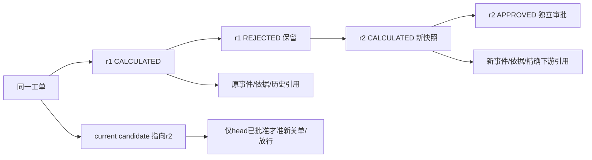

# Batch 4 制造成本金额与不可变修订定稿提案

**DESIGN_ONLY，待财务与业务负责人批准，未改变正式算法/状态机/历史单据。** 承接Batch2/3及隔离原型07553cf。本文件给出可实施的首选契约；推荐值不是企业已确认口径。已有BOM产出基数、MRP销售订单来源规则保持。

## 决策编号与已证事实

本批沿用Batch2稳定含义：C1修订资格、C2依据选择、C3当前有效口径、C4撤回。Batch3把C2–C4改用于其他议题，只是同日历史提案，不能据旧代号转移批准；下文C3.a等是子项。M1为金额契约，税/汇率与利润收入口径分别关联M1.e/P1。

0048迁移的金额/单价/小时费率是numeric(24,6)，金额精确CHECK要求分项之和=总额、实际总额−计划总额=差异；差异可负，政策单价/费率非负。production-cost-repositories.ts:123–139当前BOM按最新published_at选，计划/实际材料数量先trunc(...,6)；:145–154计划分钟也先trunc6；:165–205用Number计算分项和总额，再各自toFixed(6)。独立PG已证0.099999与0.100000的分项/总额冲突，不删除正确CHECK。没有在该仓储和0048范围内找到金额审批阈值，不凭空声称已有阈值。

## M1 推荐计算契约

| 层次              | 首选候选                                                                                                            | 边界与备选                                                                                 |
| ----------------- | ------------------------------------------------------------------------------------------------------------------- | ------------------------------------------------------------------------------------------ |
| M1.a 输入         | 制造数量、单价、小时费率继续最多6位十进制字符串；拒绝无穷、科学计数、超限及未批准额外精度                           | 六位是现行存储兼容候选，不等于所有付款币种六位；不能悄悄截断新输入                         |
| M1.b 数量/时间    | 本批金额修复保留既有材料数量和计划分钟的trunc6输出为成本输入；BOM输出基数公式不变                                   | 改数量量化模式或分钟生成方式属于另一项制造规则决定，不能混入舍入修复                       |
| M1.c 中间值       | BigInt定点/精确有理数计算；乘除不经Number，不在小时换算minutes/60处先截断                                           | 无重复量化；范围检查覆盖numeric(24,6)边界和各中间值，不让数据库溢出充当表单提示            |
| M1.d 存储舍入     | 首选对称HALF_AWAY_FROM_ZERO，量化到6位；负零统一0.000000。财务也可选择HALF_EVEN，须明确同一公式版本                 | 当前Number/toFixed行为不被直接视为已批准模式；不能仅靠展示层toFixed修正数据                |
| 材料              | 使用已存数量×冻结单价；每条材料计算计划/实际成本并量化6位，明细金额写入新版本snapshot，再精确求材料分项             | 若改为聚合原始乘积后才舍入，会与逐条金额之和不同，须明示余差/明细策略，不能暗塞某原料      |
| 人工/机器/间接费  | 各类按确切分钟总量×对应每小时费率÷60，类内一次Q6；间接费仍是每机器小时费率，不改成百分比                            | 当前未存每工序金额；若未来持久化工序金额，须另明确“逐存储行量化后求和”的层级，不混两种口径 |
| 总额/差异         | planned_total=四个已存计划分项之和；actual_total同理；variance_total=两个已存总额之差                               | 不再独立重算总额；保持数据库CHECK。报价正式定点算法、历史成本和外部法定账务不在本批改动    |
| M1.e 币种/税/汇率 | 内部成本精度与commercial_currencies.decimal_places结算/展示精度分开；冻结源币、税基、是否可抵扣、汇率来源/方向/时点 | 当前制造政策只有币种和费率，未定义税/汇率属性；未知标未知，不默认含税或按核算当天汇率回填  |
| M1.f 阈值         | 现有独立审批不新增金额阈值；如负责人要求阈值，另定正负差异、等值边界、舍入前后及汇率时点                            | 不以新增阈值绕过异人审批，不因差异为负自动免审                                             |

材料行边界（独立静态复核新增，尚未运行复现）：0036只约束BOM行号，允许同组件多行；现仓储按每BOM行重复读取工单+组件汇总actual_quantity，可能重复归集实际领料。计划数量保留逐BOM行；新实际归集应按组件+冻结计价依据先去重一次，再选择明确的可审计分摊到BOM行；无法归属不得默认为每行全量。此项登记TD-COST-003候选，需独立PG重复组件样本确认及单独业务裁定，不混入舍入修复。上表“每条材料”不授权重复计入同一实际移动。

参考公式：Q6为批准后的统一模式；material=ΣQ6(q_i×p_i)，labor=Q6(Σminutes_i×labor_rate/60)，machine/overhead使用各自分钟/费率；total=已存四分项之和。snapshot写出每项输入的来源/版本、原始十进制或有理数依据、量化值、公式版本及模式，保证独立重算。材料数量/分钟既有截断与金额Q6分别标识，不能把它们说成同一舍入步骤。

边界矩阵至少：±0.0000005/±0.0000015的tie、上下邻值、负零、三条0.0000005先分项与先聚合差异、超JS安全整数、六位极小数量×大单价、÷60循环小数、恰好0/最大范围/溢出、零费率、负单价拒绝、负差异允许、不同币种decimal_places、税基未知/FX反向/日期变化、阈值相等。独立PG numeric基准和显式模式参考实现须逐向量对账；不能把PG默认round当成企业已批准规则。旧run原字节和hash保留；新计算版本只作用新run。

## C1–C4 推荐状态机与数据模型

首版保持CALCULATED/APPROVED/REJECTED三个run状态。仅当前REJECTED且工单未CLOSED时，具有当前核算权的原申请人或核算岗可追加新run；旧run不改成CALCULATED，不引入待审撤回。APPROVED/已关闭业务的调整走另批调整单，不普通修订。每次重新核算仍由异于本次计算人的审批人批准。

建议新增revision/previous_run_id/basis_manifest_id/calculation_version与每工单唯一head资源；唯一(tenant,workorder,revision)，run号/意图键仍唯一。事件仍追加，绑定确切run及hash。工单的head是最新候选；lastApproved仅供历史展示，不能在head待批/驳回时回落到旧APPROVED放行（C3）。下游新动作记录确切run和approvalEventId；旧报价/合同/订单不悄悄换引用。

C2默认沿用原政策和可证BOM/价格依据。原run无BOM pin时不得按今日最新反推历史；新修订须明确“历史依据未知，经批准采用的新依据”，列差异。0048:39–48当前缺费率触发器检查所有已发布BOM，实施pin后须新增迁移按本次manifest检查，不删除缺费率拒绝。需要重新生成材料与报工快照，不仅复制旧金额。

C3.a事务：修订、批准、关单与发运门卫统一锁工单→当前head→目标run/事件，锁内重读状态与预期head。相同意图当前授权后返回原结果；不同意图争同一head只一成功，另一409，明细/head/审计/outbox原子提交。仅给每个run加锁不足以保护跨版本竞争。

C3.b幂等：重放先核当前权限和原对象范围、主体/指纹，再回旧收据；不把新建expectedCurrentRunId检查置于合法重放之前（创建后head已变）。旧批准事件收据可只读重放，但不重新改head或满足新放行；首次批准旧非head版本必须409。失败事务不能留下head、半条修订链或成功证据。

C4首版不新增撤回；若选择撤回，必须另定义终态、谁可撤回、是否使下游失效及重提交链，不能用改旧事件模拟。历史单run映射revision1保持旧URL读，缺依据标未知，不覆盖旧hash。已发生多版后旧程序不能被允许按“任意批准run”关单，回退须识别新head并保留新状态只读/写禁用；不能靠恢复旧binary容错。

## API、界面与实施顺序

建议POST /production-cost-runs/:id/revisions（稳定意图键、expectedCurrentRunId、原因、依据选择/差异）；GET /production-orders/:id/cost-history返回head、历史、适用性和阻断原因；批准仍针对确切run。服务端每次读/返回结果分别验证当前read范围和fields，写权限不扩大响应读取。

界面按工单展示待核算/待审批/驳回待修订/已批准、当前版和只读历史、依据差异、驳回原因及独立审批；保留失败输入，冲突后刷新head再决定新意图。不能继续按run数计算工单完成率，也不能有任一run就隐藏修订入口（现production-cost-view.ts:73–106）。

实施依赖：M1批准→金额引擎/独立基准单独提交；C1–C4与V1依据批准→兼容ADR及向前迁移→head服务与API→审批/关单/发运统一门卫→界面。金额修复、修订状态机及G5不得混提交。验证包括r1驳回/r2异人批准、自己审批拒绝、旧版审批409、同键与双意图并发、修订对关单竞争、撤权重放、后写失败全回滚、旧单run兼容及独立金额对账。正式业务口径未批前，只保设计/隔离原型，TD-COST-001/002仍开放。
